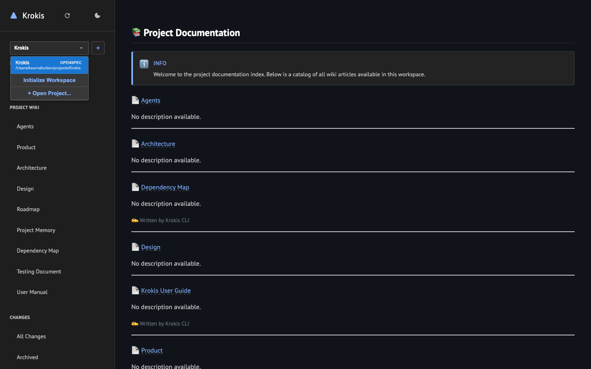
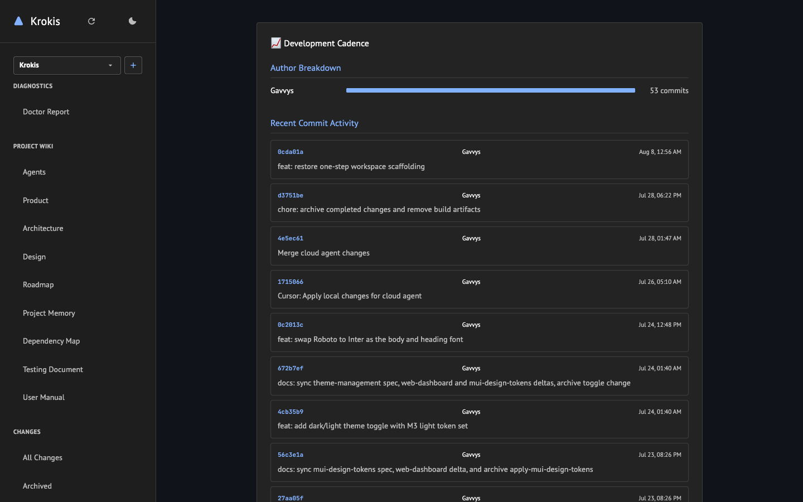
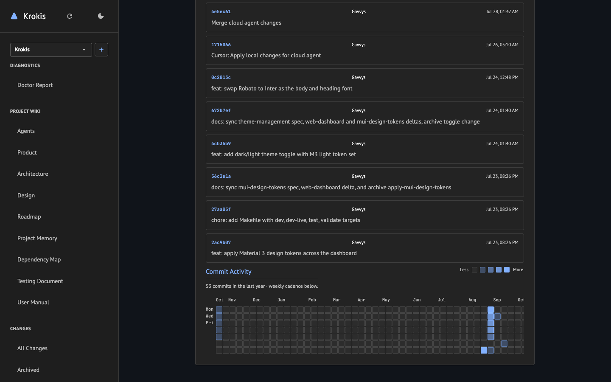
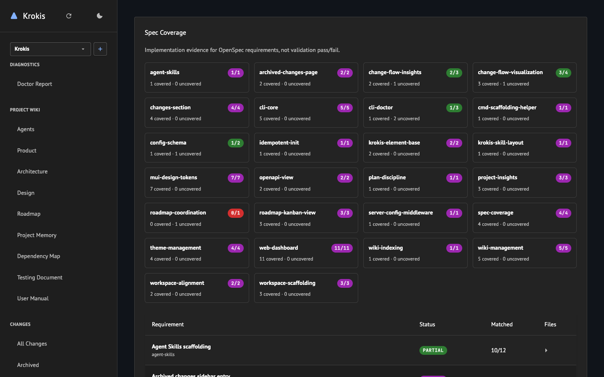
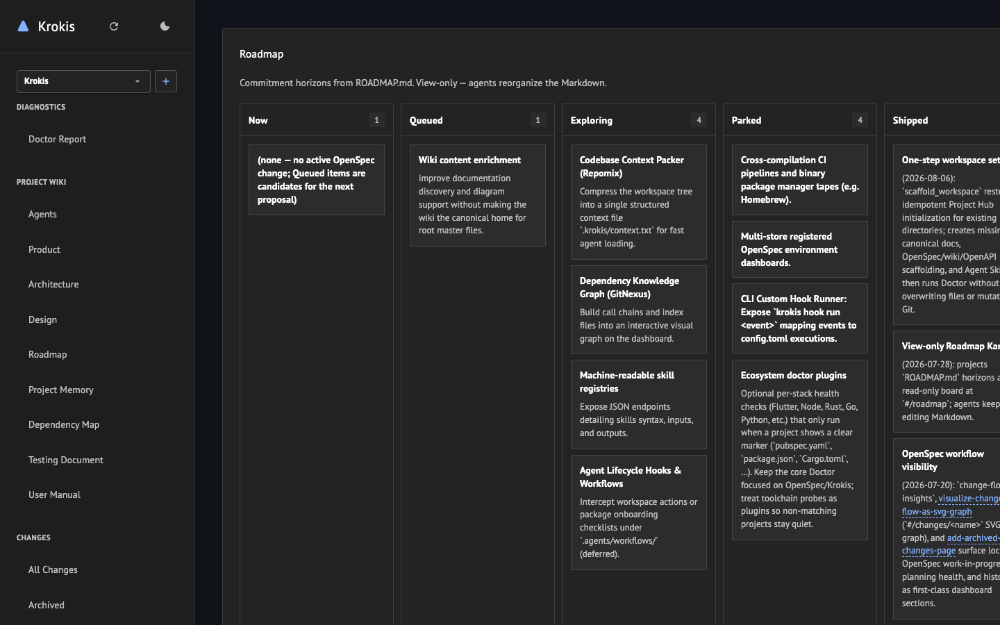
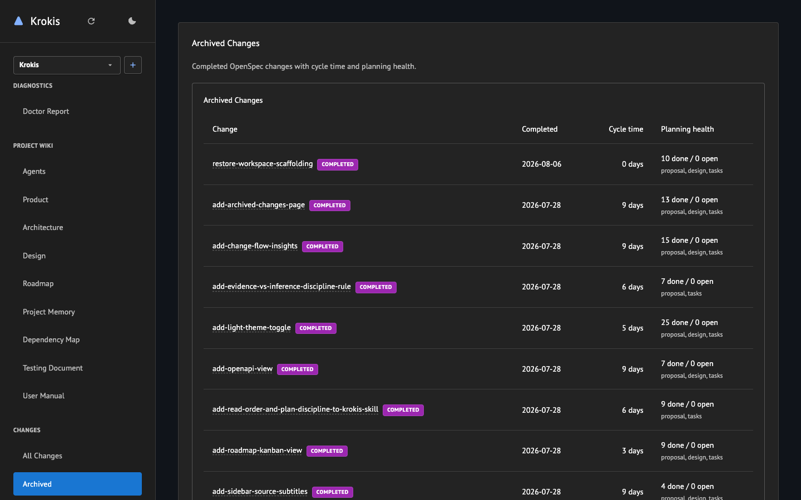
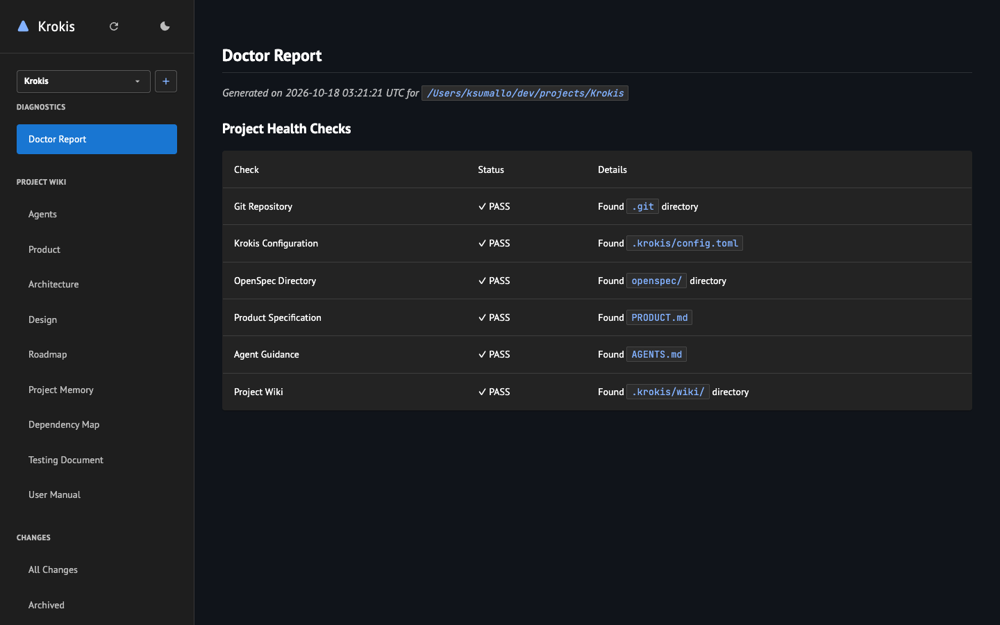
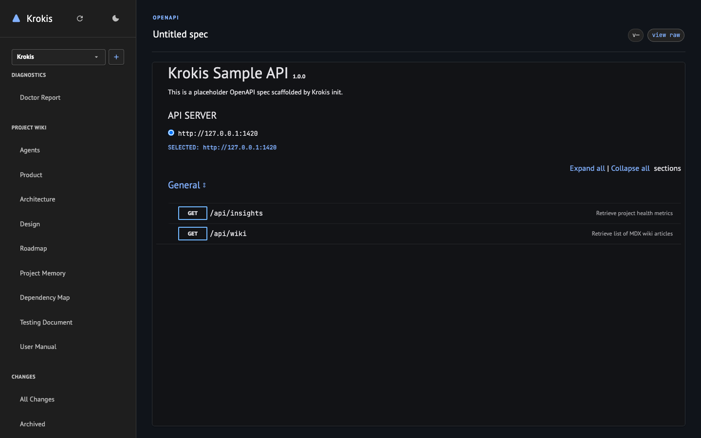

# Krokis

Spec-driven project management for local OpenSpec repositories: a native desktop dashboard for developers and AI agents who share the same project artifacts.

## What is Krokis?

OpenSpec-driven repositories spread their context across many files: `AGENTS.md`, `PRODUCT.md`, `ARCHITECTURE.md`, `openspec/specs/`, `openspec/changes/`, and wiki pages. Reading all of that to answer "what is the state of this project?" is slow for people and easy for agents to get wrong.

Krokis is a Tauri v2 desktop app that opens a local repository and turns it into one visual surface. A Rust backend scans the workspace and computes telemetry: git commit cadence, lines of code, OpenSpec change flow, and spec-to-code coverage. The frontend renders the canonical documents, the project wiki, a read-only roadmap board, and a Doctor report that tells you what a workspace is missing.

It is for developers running OpenSpec projects locally, and for AI agents that read the same artifacts Krokis displays. Krokis never commits to your repository and never rewrites existing files; it reads your git history and adds only missing scaffolding when you ask.

Current maturity: usable prototype at version 0.2.0 (`src-tauri/Cargo.toml`). Core views work, test coverage is limited to roadmap parsing and workspace scaffolding, and some views have known gaps (see [Status](#status)).

## Screenshots



*Project Hub selector and the wiki documentation index.*



*Task Cadence: author breakdown and recent commits.*



*Commit Activity heatmap for the trailing 365 days.*



*Spec Coverage: implementation evidence per OpenSpec requirement.*



*Roadmap kanban board projected from ROADMAP.md.*



*Change flow: archived changes with cycle time and planning health.*



*Doctor Report: workspace health checks.*



*API Specification (RapiDoc) view.*

## Features

**Workspace and setup**

- **Project Hub**: switch local repositories from a sidebar dropdown, with recent-project memory and a native OS folder dialog (`web/components/ProjectSelector.js`, `src-tauri/src/lib.rs`).
- **Initialize Workspace**: create missing canonical documents, wiki pages, OpenSpec config, an OpenAPI starter, and agent skills in one click. Existing files are never overwritten (`src-tauri/src/scaffold.rs`).
- **Doctor report**: check a workspace for a git repository, Krokis configuration, an OpenSpec directory, `PRODUCT.md`, `AGENTS.md`, and a wiki, then save the result to `.krokis/DOCTOR.md` (`src-tauri/src/doctor.rs`). If the workspace is a Flutter project or `flutter` is on your PATH, Doctor also runs `flutter doctor` and appends the output.

**Reading and navigation**

- **Canonical document and wiki rendering**: browse `PRODUCT.md`, `ARCHITECTURE.md`, and the other root documents, plus `.krokis/wiki/*.mdx` pages with SNAKE_CASE names, rendered as Markdown with custom components (`web/mdx/registry.js`).
- **Dark and light themes**: toggle from the header, with the choice remembered across launches (`web/index.html`, `web/tokens.css`).
- **Resizable sidebar**: drag the divider to size the navigation between 200px and 560px (`web/app.js`).

**Insights**

- **Task Cadence**: author commit breakdown, recent commits, and a 365-day commit heatmap computed from `git log` (`src-tauri/src/metrics/git.rs`).
- **Change flow**: active and archived OpenSpec changes with age, cycle time, and planning health (which of proposal, specs, design, and tasks are present) (`src-tauri/src/metrics/change_flow.rs`).
- **Spec-to-code coverage**: every OpenSpec requirement classified as covered, partial, or uncovered by scanning workspace source files (`src-tauri/src/metrics/coverage.rs`).
- **Roadmap board**: a read-only Kanban projection of the `ROADMAP.md` commitment horizons (Now, Queued, Exploring, Parked) (`src-tauri/src/roadmap.rs`).
- **API Specification**: a RapiDoc view of the workspace `openapi.yaml`. The spec source is not wired up yet, see [Status](#status).

## Installation

### Prerequisites

- Rust toolchain (`rustup`). <!-- TODO: confirm minimum Rust version -->
- Tauri CLI v2:

  ```bash
  cargo install tauri-cli --version "^2" --locked
  ```

- Node.js with npm, for the Vite dev server the app launches during development. <!-- TODO: confirm minimum Node.js version -->
- On macOS, Xcode Command Line Tools:

  ```bash
  xcode-select --install
  ```

- The `openspec` CLI, only if you want `make validate` (`Makefile` calls `openspec validate --all --strict`). <!-- TODO: confirm where the openspec CLI is distributed -->

### Setup

```bash
git clone https://github.com/Gavvys/krokis.git
cd krokis
npm install
```

Run the desktop app in live development mode:

```bash
make dev
# or
cargo tauri dev
```

Build a standalone native bundle for your OS:

```bash
make build
# or
cargo tauri build
```

Platform notes: macOS is the demonstrated path (the window uses the macOS `Overlay` title bar style in `src-tauri/tauri.conf.json`). Tauri bundles per-platform targets, but Windows and Linux builds are untested here. <!-- TODO: confirm Windows/Linux build status -->

## Configuration

No `.env` files are used. Settings live in the OS environment, browser storage, or a per-project file:

| Variable or setting | Required | Default | What it does |
| --- | --- | --- | --- |
| `HOME` (or `USERPROFILE` on Windows) | Implicitly | OS home directory | Krokis locates its global data directory `~/.krokis` from it (`src-tauri/src/logger.rs:26`) |
| `krokis.theme` (localStorage) | No | `dark` | UI theme, `light` or `dark` (`web/index.html:11`) |
| `krokis.sidebarWidth` (localStorage) | No | 280 | Sidebar width in px, clamped to 200..560 and half the window (`web/app.js:164`) |
| `.krokis/config.toml` (per project) | No | Scaffolded by Initialize Workspace | Marks a directory as a Krokis workspace and holds `[wiki]`, `[insights]`, and `[server]` starter keys (`src-tauri/src/scaffold.rs:43`). The keys themselves are not read by the app yet. <!-- TODO: confirm whether config.toml keys are honored anywhere --> |

Data locations: the project registry is `~/.krokis/projects.json`, logs append to `~/.krokis/app.log` and `~/.krokis/errors.log` (`src-tauri/src/projects.rs:41`, `src-tauri/src/logger.rs:37`). Per-project output (wiki, scaffolding, `DOCTOR.md`) stays inside the workspace under `.krokis/`.

## How to Use

Quick start: run `make dev`, pick your repository in the Project Hub dropdown (the "+" button opens a native folder picker), then choose **Initialize Workspace**. A toast reports how many files were created and how many already existed, and the sidebar fills with your wiki pages and diagnostics. Click **Doctor Report** to see what the workspace is missing.

Common workflows:

1. **Onboard an existing repository.** Open the folder in the Project Hub, run **Initialize Workspace**, read the generated `AGENTS.md` and `.krokis/wiki/USER_MANUAL.mdx`, and edit them to fit the project. Files that already exist are kept as-is.
2. **Check project health.** Open **Doctor Report** in the sidebar (or re-run Doctor after changing the workspace). The report lands in `.krokis/DOCTOR.md`, so it is readable by agents too.
3. **Review OpenSpec work.** Use **All Changes** and **Archived** for change age, cycle time, and planning health, and **Roadmap** for the Kanban view of `ROADMAP.md` horizons.
4. **Measure progress.** Use **Task Cadence** for commit activity and **Coverage** for which requirements have code behind them. The refresh button in the header re-runs the telemetry scan.

Dashboard routes (also reachable by URL hash):

| Route | What it shows |
| --- | --- |
| `#/wiki/<NAME>` | Rendered MDX wiki page or canonical document (`PRODUCT.md`, `ARCHITECTURE.md`, etc.) |
| `#/insights/cadence` | Author commit breakdown, recent commits, and a 365-day commit heatmap |
| `#/changes` | Active OpenSpec work with change age, cycle time, and planning health |
| `#/changes/archived` | Completed OpenSpec changes with completion date and cycle time |
| `#/roadmap` | Read-only Kanban projection of `ROADMAP.md` commitment horizons |
| `#/insights/coverage` | Spec-to-code coverage per OpenSpec requirement: covered, partial, or uncovered |
| `#/insights/openapi` | RapiDoc viewer for the workspace OpenAPI specification |

## FAQ

**Does Krokis commit to or change my git repository?**
No. It runs read-only `git log` commands (`src-tauri/src/metrics/git.rs`) and never commits, stages, or rewrites anything in `.git`. It does write plain files: Doctor saves `.krokis/DOCTOR.md`, and Initialize Workspace creates files that are missing.

**What exactly does Initialize Workspace create?**
Root documents (`AGENTS.md`, `PRODUCT.md`, and the rest of the canonical set), `.krokis/config.toml`, three starter wiki pages, `openapi.yaml`, `openspec/config.yaml`, and an agent skill under `.agents/skills/krokis/` (`src-tauri/src/scaffold.rs`). Every file is created only if absent, using an exclusive create, so existing content is never overwritten.

**Where does Krokis store its own data?**
Globally in `~/.krokis/`: `projects.json` for the recent-project registry, `app.log` and `errors.log` for logs. Everything else is written inside the workspace you opened, under `.krokis/`.

**Why do wiki pages need SNAKE_CASE names?**
Wiki page names must be uppercase letters, digits, and underscores (`src-tauri/src/wiki.rs:6`). The wiki list, page creation, and the `#/wiki/<NAME>` route all assume it, and it keeps route URLs stable.

**Which folders can I open as a project?**
Any directory containing `PRODUCT.md`, `AGENTS.md`, an `openspec/` directory, `.krokis/config.toml`, or `.krokis/wiki/` (`src-tauri/src/projects.rs:59`). Your home directory is refused on purpose, so run Initialize Workspace on a specific project folder instead.

**Can I run the UI in a plain browser?**
`npm run dev` serves the frontend at `http://127.0.0.1:1420`, but data loading goes through the Tauri IPC layer (`window.__TAURI__.core.invoke`). Without the desktop shell the views fall back to `/api/*` fetches that have no backend, so pages come up empty. Use `make dev` for real work. <!-- TODO: confirm intended browser-only workflow -->

**Why is the API Specification page empty?**
The RapiDoc element loads its spec from `/api/openapi`, and nothing in the app serves that path yet (`web/app.js:39`). Wiring the workspace `openapi.yaml` to this view is outstanding work, see [Status](#status).

**Does it work offline?**
The JavaScript libraries are bundled in `web/vendor/`, but the UI loads PT Sans and JetBrains Mono from Google Fonts (`web/index.html:28`), and RapiDoc can fetch a webfont of its own. On an air-gapped machine the app works with fallback system fonts. <!-- TODO: confirm acceptable offline behavior -->

## Project Structure

```text
krokis/
├── web/                  # Frontend: HTML shell, hash router, styles
│   ├── app.js            # Router, pages, IPC calls, theme and sidebar
│   ├── components/       # Custom elements (project selector, charts, cards)
│   ├── mdx/registry.js   # Components available inside MDX wiki pages
│   └── vendor/           # Bundled marked, Prism, RapiDoc (offline)
├── src-tauri/            # Rust backend (Tauri v2)
│   └── src/              # IPC commands, wiki, doctor, scaffold, projects
│       └── metrics/      # git, codebase, change flow, coverage scanners
├── openspec/             # OpenSpec specs and archived changes
├── .agents/skills/       # Agent skills scaffolded into new workspaces
├── Makefile              # dev, build, check, validate
├── package.json          # Vite dev server and build script
└── openapi.yaml          # Sample OpenAPI spec shown in the app
```

## Development

Run the app in live development mode (starts the Vite dev server, then the Tauri shell):

```bash
make dev
```

Type-check the Rust backend:

```bash
make check
```

Run the tests:

```bash
cd src-tauri && cargo test
```

There is no `test` target in the `Makefile`, and there are no JavaScript tests or lint configuration in the repository. The Rust unit tests cover roadmap markdown parsing (`src-tauri/src/roadmap.rs`) and workspace scaffolding (`src-tauri/src/scaffold.rs`). <!-- TODO: confirm lint tooling choice -->

Validate OpenSpec artifacts (requires the `openspec` CLI):

```bash
make validate
```

`npm run build` produces `web/dist/`, but the Tauri build bundles `web/` directly (`src-tauri/tauri.conf.json`), so that script is not part of the release path.

Contributing follows the project's spec-driven workflow: propose the change with the `openspec-propose` skill, implement it as small conventional commits (`feat:`, `fix:`, `chore:`), then archive it with the `openspec-archive-change` skill so the delta specs land in `openspec/specs/`. Before writing code, read `AGENTS.md`, then `PRODUCT.md`, the relevant `openspec/specs/<capability>/spec.md`, `ARCHITECTURE.md` and `DESIGN.md`, `PROJECT_MEMORY.md`, and any active change in `openspec/changes/`.

## Status

- **Maintenance**: version 0.2.0 (`src-tauri/Cargo.toml`). Last commit 2026-08-08 (`0cda01a feat: restore one-step workspace scaffolding`); 53 commits total, almost all between 2026-07-20 and 2026-08-08. Treat this as a prototype that works, maintained in bursts.
- **Known limitations** (evidence in the code):
  - The API Specification page has no spec source; `/api/openapi` is fetched but not served (`web/app.js:39`, `web/app.js:936`).
  - `.krokis/config.toml` keys are scaffolded but not read by any code path (`src-tauri/src/scaffold.rs:43`).
  - Fonts load from Google Fonts despite the offline-first goal (`web/index.html:28`).
  - `npm run build` output is unused by `make build` (`src-tauri/tauri.conf.json`).
  - `tauri-plugin-store` is registered but no code uses it (`src-tauri/src/lib.rs:383`).
  - Tests cover only roadmap parsing and scaffolding; the metrics parsers (`src-tauri/src/metrics/`) have none.
  - No CI configuration in the repository.
- **Written intentions** (from `ROADMAP.md`, not commitments made here): the Queued item is "Wiki content enrichment", and Exploring items include a codebase context packer and a dependency knowledge graph. See `ROADMAP.md` for the full list.

## Tech Stack

- **Languages**: Rust for the backend, IPC commands, and telemetry scanning; JavaScript (no framework, custom elements) for the UI; CSS with Material-style design tokens in `web/tokens.css`.
- **Frameworks**: Tauri 2 (2.11.5 in the lockfile) for the desktop shell and IPC; Vite 8.1.5 as the dev server the shell starts.
- **Major dependencies** (from `src-tauri/Cargo.toml`): `tauri-plugin-dialog` for the native folder picker, `serde` and `serde_json` for IPC and registry serialization, `chrono` for date math, `regex` and `walkdir` for source scanning, `tokio` for one IPC channel. Frontend vendors marked 15.0.12, Prism 1.29.0, and RapiDoc 3.38.1 in `web/vendor/`.
- **Tools**: Tauri CLI v2 (`cargo tauri dev|build`), GNU Make (`Makefile` targets), npm for the frontend dev dependency, the OpenSpec CLI for `make validate`.

---

[KROKIS](./) · [PRODUCT.md](./PRODUCT.md) · [ROADMAP.md](./ROADMAP.md) · [AGENTS.md](./AGENTS.md)
